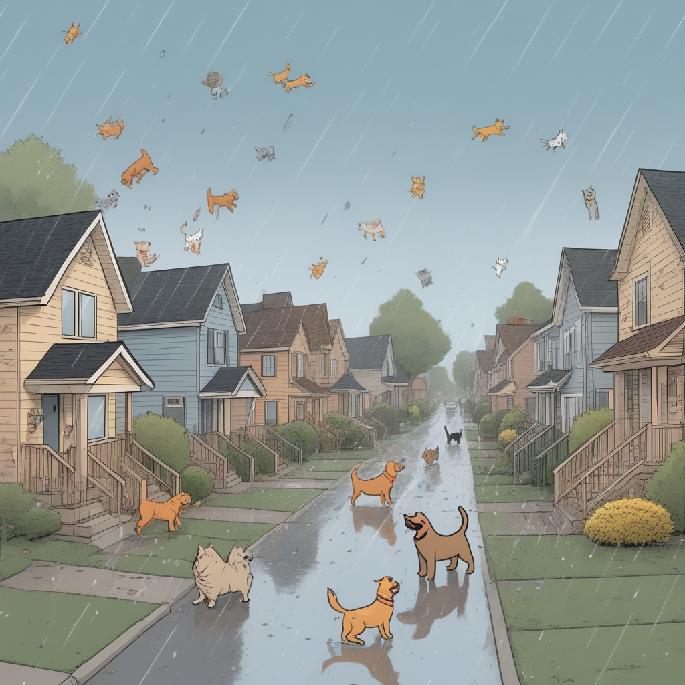

# Test Page


1

> quoted block
> * List under a quoted block
> * second list in q auoted block


Not in quoted block.
1. numbered item 
2. second numbered item
	* unordered under second
	* 
unordered second under second numbered

* Another list item 

* Third list item

1. first
2. second
3. third

Image pasted in (raining cats and dogs):


```comment c1 0.62,0.7837
:: 0
@2026-10-16T22:04:35.575Z Operator
Dog!
```
```comment c2 0.7108,0.1918
:: 0
@2026-10-16T22:04:51.991Z Operator
Cat!
```
```comment c3 0.3202,0.2885
:: 0
@2026-10-16T22:05:09.863Z Operator
Cat!
```
```comment c4 0.3153,0.1177
:: 0
@2026-10-17T14:52:40.646Z Operator
WTF??
```

And some text below the image.

