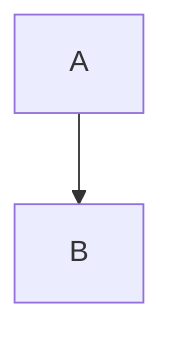

title: Markdown in a ticket
state: new
type: task
priority: medium
parent:
depends:
reporter: Viewmark
created: 2026-10-05T00:00:00.000Z

# Markdown in a ticket

The body of the ticket is the document the page draws.

- A list item is a sentence in the ticket.

> A quote is a sentence in the ticket.

```python
print("ticket")
```



| Field | Value |
| --- | --- |
| State | new |
