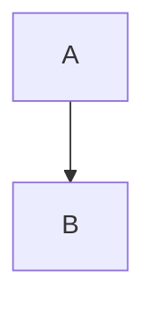

# Welcome

This page draws **bold** text and *emphasis* in one sentence. Inline code such as `print` stays inside that sentence.

> A quote is its own sentence on the page.

A bullet list draws each item:

- The first item is a complete sentence.
- The second item is a complete sentence.

An ordered list numbers its sentences:

1. Open the document and read the first sentence.
2. Leave the source as the stored text.

A link such as [these notes](https://example.com/notes) sits inside a sentence.

A horizontal rule separates the sentences above from the table below.

---

A table draws a heading row and a body row.

| Mark | Drawn |
| --- | --- |
| Bold | yes |

A python fence draws its source as code.

```python
print("hello")
```

A mermaid fence draws a diagram from `graph TD` with two nodes.



An HTML tag such as <em>word</em> is stored as text and is not rendered.

The open thread marks {c1}this span{/c1} in the sentence.

```comment c1
:: 0
@2026-10-05T16:00:00.000Z Ada
This note is the start of the thread.
:: 1
@2026-10-05T16:05:00.000Z Bea
A reply keeps its own author line.
```

## Vim keys
The document menu item Vim keys is off until it is checked. The browser remembers the choice for every document it opens, and stores it as `viewmark.vim`. The hub does not store it. A status beside that menu shows `N` for normal, `I` for insert, `V` for character visual, and `VL` for line visual. A count or an operator that is still waiting shows there instead of the letter. Normal and both visual modes draw a block caret. Insert keeps the thin caret.

Escape, or Ctrl-[, leaves insert or visual and returns to normal. `i` inserts at the caret, `a` after the next character, `I` at the first non-blank of the vim line, `A` at the end of that line, and `gI` at the first column. `o` opens a line below and `O` a line above, then insert. In visual, `o` and `O` swap the ends of the highlight. `v` and `V` enter or leave those two visual modes, and each switches to the other. In insert, Ctrl-W or Command-W deletes the word before the caret, Ctrl-U deletes back to the start of the source line, Ctrl-T adds a leading tab, Ctrl-D removes one, and Ctrl-O runs one normal command and then returns to insert. Arrow keys in insert move and stay in insert. In the other modes that W chord is taken and does not change the text, so it does not close the browser tab.

A vim line in the formatted view is a rendered block. `j` and `k` move by that block, not by a source line and not by a wrapped row. A code fence is the exception: inside it, `j` and `k` move one line of code, and `V` selects lines of code, as in stock vim (g92jk6em). A paragraph is one line when it wraps, and a single newline inside it stays on that line. The blank between paragraphs is not a line, so `j` does not land there. `gj` and `gk` move by display row. `g0`, `g^`, and `g$` are that row's start, first non-blank, and end. In the raw view a vim line is one source line, and those `g` motions are `j`, `k`, `0`, `^`, and `$`. `w` can leave the line. `dw` and `cw` stop at the end of it. A linewise delete in the formatted view also takes the blank under the block. A linewise change leaves that blank and opens one empty line. `j` does not step onto the empty row after a final newline. `k` from that row returns to the last block.

Comment markers and the tail of a hard break are skipped. The caret does not sit inside them. `r` and `~` change ordinary text on the vim line. A count that would include a line break or a comment marker changes nothing. Deleting one side of a comment keeps the comment on the text that remains. Deleting both sides takes the comment with the text.

`gc` comments the highlight. In visual or visual line, `gc` on a highlight that is not already a comment adds one and opens an empty note. The mode stays visual or visual line until Ctrl-Enter or Command-Enter saves the note and returns to normal. A refused range, such as a highlight that is only a list marker, writes nothing and leaves the highlight. `gc` with the caret on an existing comment makes that thread current, and visual or visual line `gc` does the same when the highlight is already inside that comment. Then `r` replies, `R` resolves or reopens for the author of the first note, `X` deletes for that author, `Y` copies the link, and `i` opens the earliest note this session authored. Escape deselects the thread, discards an unsaved reply or revision, and normal navigation resumes. Normal `gc` off a comment does nothing. `c` is still change. In visual line, `R` still changes the highlighted lines. While a thread is current, `R` resolves or reopens for the first note's author instead. Elsewhere `R` is not replace mode.

`y` and `p` use one unnamed register, which is not the clipboard. `"` does not select another register. `p` puts after the caret and `P` before it. A linewise register opens its own line. `]p` and `[p` put that line and then reindent it, as one edit. Ctrl-C copies a visual selection to the clipboard and stays visual. Ctrl-X cuts it and returns to normal. Ctrl-V pastes the clipboard. That paste works in normal, in visual, and in insert. There is no visual-block mode. `u` undoes in normal, and Ctrl-R redoes. Ctrl-Z undoes as well, including in visual, and Ctrl-Y and Ctrl-Shift-Z redo. In normal, `U` changes nothing. In visual, `u` and `U` change case. `.` in normal repeats the last change at the caret, and a count typed before `.` replaces the count stored on that change. There are no macros and no marks. Ctrl-A selects the whole file as a line visual selection.

Search text is literal. `/` and `?` remember earlier patterns for the life of the page. That history is page memory. It is not stored in the document and it is not sent to the hub. Up-arrow recalls the previous pattern. Down-arrow walks back to the draft. Matches are painted while the pattern is typed and after Enter. `:noh` clears that paint and leaves the pattern, so `n` still repeats. `/` searches forward and `?` backward. Enter runs the line and Escape closes it. `n` and `N` repeat the search. `*` and `#` search the word under the caret as a whole word, and `g*` and `g#` search it without that limit. `gn` and `gN` select the next or previous hit. A search wraps once. No hit leaves the caret where it is.

`w` and `W` are the same motion, and so are `b` and `B`, `e` and `E`, and `ge` and `gE`. A word runs until whitespace, so the punctuation it touches stays on it. Counts are typed before the command and stop at 10000. The digit `0` starts a count only after another digit. Alone, `0` is the first column.

Motions are `h` `l` `j` `k` and the arrow keys, `0` `^` `$` `|`, `gg` and `G` with a count for a vim line, `w` `b` `e` `ge`, `f` `F` `t` `T` then `;` and `,`, `%` on brackets, `{` and `}` by block, and `H` `M` `L` for the top, middle, and bottom of the rows on screen. `+`, `-`, and Enter move by line and land on the first non-blank. `_` does that on the counted line, where 1 is the current line. Ctrl-F and Ctrl-B move by the rows on screen, and Ctrl-D and Ctrl-U move by half of them. `zz`, `zt`, and `zb` put the caret's line at the center, the top, or the bottom. `z.`, `z-`, and `z` followed by Enter do that and also move to the first non-blank. Ctrl-N and Ctrl-P are `j` and `k`. Home is `0`, End is `$`, Page Up is Ctrl-B, and Page Down is Ctrl-F. Space is `l` and Shift-Space is `w`. Backspace is `h` and Shift-Backspace is `b`. Delete is `x`.

Operators are `d`, `c`, `y`, `>`, `<`, `=`, `gu`, `gU`, and `g~`. Doubled, they act on the vim line, and a count is that many lines. `D` and `C` run through the end of the line. `x` and `X` delete characters and stay on the source line, stopping before its newline. `s` deletes those characters and enters insert. In visual, `s` changes the highlight. `S` changes whole vim lines and enters insert. In visual line, `R` and `S` change the highlighted lines. While a thread is current, `R` resolves or reopens for the first note's author instead. Elsewhere `R` is not replace mode. `Y` yanks the line. `J` joins with a space and `gJ` joins without one. `r` replaces the following characters with the next key, and Enter as that key writes one line break for the whole count. `~` toggles case. `>` and `<` are a list indent, not a shift of spaces. `>` writes one leading tab, and an ordered item that starts a new level is numbered 1. On a line that is not a list item, `>` writes a tab at the start and `<` removes one leading tab. `=` changes a list item to one level under the item above, or to the top level when there is no item above, and it leaves any other line as it is. On a list item, `<<` lands on the item text. Tab and Shift-Tab in normal and visual are `>` and `<`. In insert, Tab is the ordinary list indent, and Shift-Tab inserts a tab character.

Text objects follow an operator, or they extend a visual selection. They are a word (`iw`, `aw`), an inline code span (inner or around a backtick), a single or double quote that closes on the source line, a link label (`i[` and `a[`, or the same with `]`), and a block (`ip`, `ap`). `aw` takes the spaces after the word, or the spaces before it when none follow. `ip` stops before the block's own newline. `ap` also takes the blank lines after the block, or the blank lines before it when nothing follows.

`:` opens a command line in normal. In visual it returns to normal and writes nothing. The names are `delete` (`d`), `join` (`j`), `yank` (`y`), `undo` (`u`), `redo` (`red`), and `substitute` (`s`). A shorter name works when it is a prefix of that word and at least as long as the short form. `%d` clears the document and yanks it as a line. Without `%`, delete, yank, and substitute use the source line, and join joins the way `J` does. `:s/old/new/` replaces the first literal `old` on that span. A final `g` replaces every match. `%s/old/new/g` covers the whole document. A slash inside a field is written `\/`. Any other range is refused, and an unknown command changes nothing.

A vim edit is still an edit. A span another person holds is refused, the text stays, and that person's name flashes on the span.
