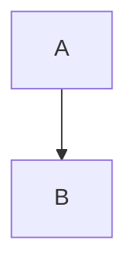

# Welcome

This page draws **bold** text and *emphasis* in one sentence. Inline code such as `print` stays inside that sentence.

> A quote is its own sentence on the page.

A bullet list draws each item:

- The first item is a complete sentence.
- The second item is a complete sentence.

An ordered list numbers its sentences:

1. Open the document and read the first sentence.
2. Leave the source as the stored text.

A link such as [these notes](https://example.com/notes) sits inside a sentence.

A horizontal rule separates the sentences above from the table below.

---

A table draws a heading row and a body row.

| Mark | Drawn |
| --- | --- |
| Bold | yes |

A python fence draws its source as code.

```python
print("hello")
```

A mermaid fence draws a diagram from `graph TD` with two nodes.



An HTML tag such as <em>word</em> is stored as text and is not rendered.

The open thread marks {c1}this span{/c1} in the sentence.

```comment c1
:: 0
@2026-10-05T16:00:00.000Z Ada
This note is the start of the thread.
:: 1
@2026-10-05T16:05:00.000Z Bea
A reply keeps its own author line.
```
